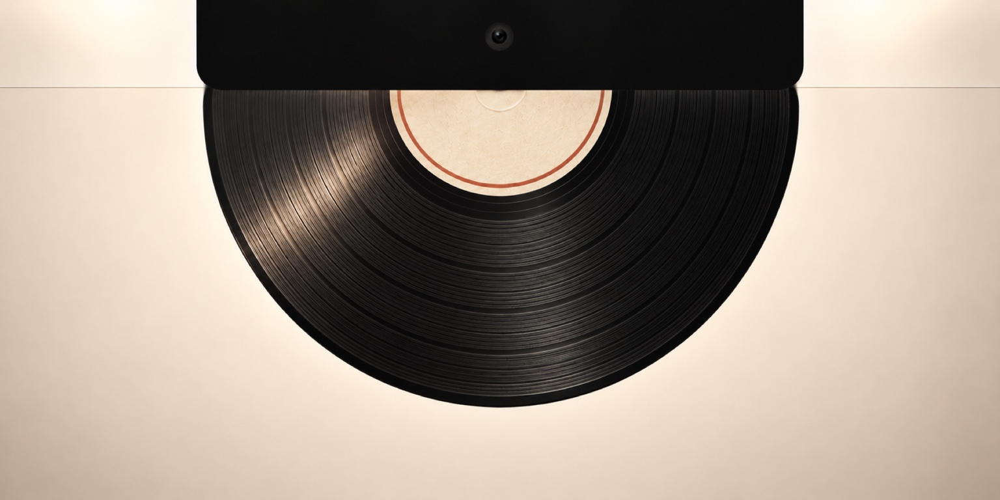
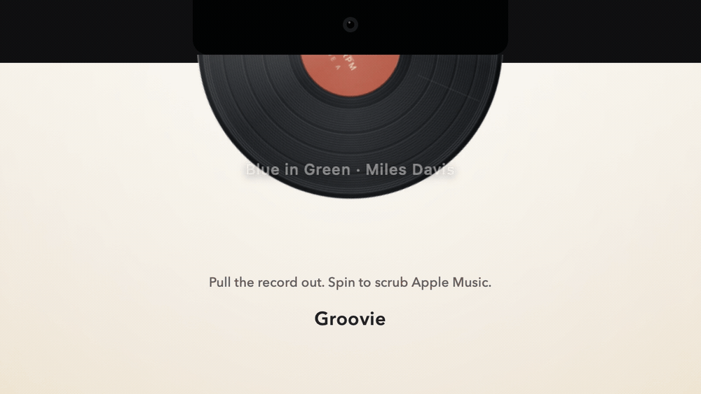
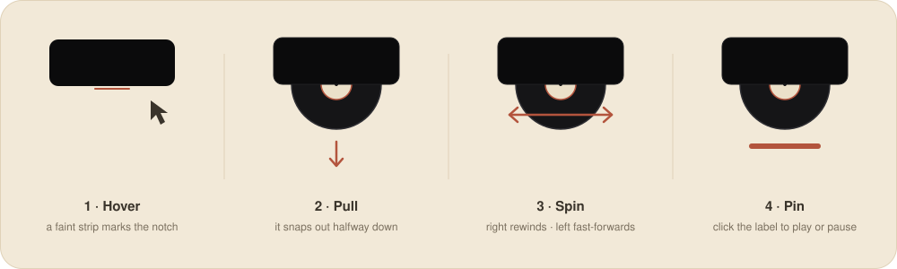
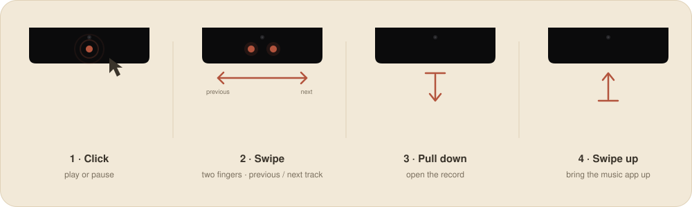

<p align="right"><a href="README.md">English</a> · 한국어</p>

<p align="center">
  <picture>
    <source media="(prefers-color-scheme: dark)" srcset="docs/assets/hero-dark.jpg">
    
  </picture>
</p>

<h1 align="center">Groovie</h1>

<p align="center"><em>맥북 노치 속에 숨은 턴테이블.</em></p>

<p align="center"><strong>클릭으로 멈추고, 스와이프로 넘기고, 당겨서 탐색하세요.</strong></p>

<p align="center">
  <a href="#요구-사항"></a>
  <a href="#요구-사항"></a>
  <a href="#apple-music"></a>
  <a href="#동작-방식"></a>
  <a href="LICENSE"></a>
</p>

<p align="center">
  <a href="#왜-노치일까요">왜 노치일까요?</a> ·
  <a href="#기능">기능</a> ·
  <a href="#요구-사항">요구 사항</a> ·
  <a href="#설치">설치</a> ·
  <a href="#사용법">사용법</a> ·
  <a href="#동작-방식">동작 방식</a> ·
  <a href="#개발">개발</a> ·
  <a href="#튜닝">튜닝</a> ·
  <a href="#알려진-제한">알려진 제한</a> ·
  <a href="#기여">기여</a>
</p>

---

Groovie는 맥북의 카메라 노치를 Apple Music을 조작하는 작은 아날로그 덱으로 바꿔 줍니다.
레코드를 꺼내지 않고도 노치를 클릭해 재생을 멈추거나 시작하고, 스와이프해 곡을 넘기고,
레코드를 아래로 당겨 탐색할 수 있습니다. 레코드는 평소 노치 속에 숨어 있다가, 충분히
당기면 자석처럼 경쾌하게 모습을 드러냅니다. 잡고 좌우로 돌리면 재생 위치를 탐색합니다.
천천히 움직이면 정밀하게, 빠르게 움직이면 크게 이동합니다. 한 번 더 당기면 밖에 고정되어
재생/일시정지와 곡 넘기기를 할 수 있고, 놓으면 다시 노치로 들어갑니다.

복잡한 슬라이더도, 팝오버도, 정리해야 할 창도 없습니다. 레코드처럼 동작하는 바이닐 한
장으로 모든 조작을 끝낼 수 있습니다.

<p align="center">
  <picture>
    <source media="(prefers-color-scheme: dark)" srcset="docs/assets/groovie-demo-dark.gif">
    
  </picture>
</p>

## 왜 노치일까요?

노치는 언제나 검은색이고, 화면 최상단 중앙에 자리하며, 하던 작업 위에 늘 떠 있습니다.
그래서 다른 창과 경쟁하지 않으면서 아날로그적인 오브젝트가 자연스럽게 머물 수 있는 유일한
화면 영역입니다. Groovie는 노치를 레코드 슬리브로, 레코드를 컨트롤로 사용합니다.

레코드는 항상 아래쪽 반원만 보입니다. 의도된 제약입니다. 실루엣이 *슬리브에서 반쯤
나온 레코드*로 자연스럽게 연상되고, 상호작용에 명확한 휴식 지점을 줍니다.

## 기능

### 레코드

- **당겨서 잡기.** 노치 안에서 시작한 수직 드래그는 바로 당김으로 이어집니다. 중간
  지점에서 자석이 작동해 레코드가 완전히 나오고 가벼운 햅틱이 울립니다. 그 전에 놓으면
  스프링으로 돌아갑니다.
- **돌려서 탐색.** 레코드를 잡고 좌우로 움직입니다. 오른쪽은 되감기, 왼쪽은 앞으로
  감기이며, 빠른 제스처일수록 같은 거리에서 더 크게 탐색합니다. 곡의 시작이나 끝에
  닿으면 더 나아가지 않고 레코드 회전도 함께 멈춥니다.
- **고정하기.** 잡은 상태에서 더 당기거나 1초 안에 다시 잡으면 레코드가 밖에 남습니다.
  레코드 아래의 반투명 게이지가 당기는 만큼 차오르며, 빠르게 당기면 더 빨리 채워집니다.
- **되돌리기.** 바이닐 클릭, 위로 드래그, 위로 스크롤 중 하나로 닫습니다. 레코드가
  노치로 들어가고 선택한 위치에서 재생이 이어집니다. 원래 일시정지 상태였다면 그대로
  일시정지합니다.
- **흔들어 취소.** 1초 안에 방향 전환을 네 번 하면 이번 탐색을 버리고 잡았던 위치로
  돌아갑니다.
- **33⅓로 복귀.** 탐색이 끝나면 수동 회전에서 33⅓ RPM 재생 회전으로 자연스럽게
  이어집니다.

### 재생

- **레이블 클릭.** 고정된 레코드의 중앙 레이블을 클릭하면 재생/일시정지가 토글되고
  레코드는 밖에 남습니다. 레코드와 메뉴 막대 표시가 즉시 바뀝니다.
- **호버 힌트.** 고정된 레코드의 레이블에 포인터를 올리면 레이블이 어두워지고 희미한 ❚❚
  또는 ▶ 글리프가 나타나며 커서가 포인팅 핸드로 바뀝니다. 바이닐 자체는 호버에 반응하지
  않습니다.
- **곡 넘기기.** 노치 위나 고정된 레코드의 레이블 위에서 가로 두 손가락 스와이프를 하면
  다음 곡 또는 이전 곡으로 이동합니다. 고정된 레코드라도 바이닐 위에서 시작한 스와이프는
  여전히 탐색입니다.
- **노치 클릭.** 레코드가 닫힌 상태에서 노치를 한 번 클릭하면 재생/일시정지가 토글됩니다.
  재생할 트랙이 없으면 대신 활성 플레이어를 앞으로 가져옵니다.

### 노치

- **방해하지 않기.** 오버레이는 테두리 없는 비활성 패널로, 상태 바보다 한 단계 위에
  놓입니다. 포커스를 빼앗거나 앱을 활성화하지 않으며 Dock 아이콘도 없습니다.
- **노치 없이도 동작.** 카메라 하우징이 없는 디스플레이에서는 상단 중앙 스트립이 똑같이
  동작합니다.
- **첫 실행 힌트.** 노치가 없는 디스플레이에서는 스트립 아래 작은 카드가 숨은 제스처를
  소개합니다. 클릭은 재생/일시정지, 두 손가락 스와이프는 곡 넘기기, 아래로 당기기는
  레코드 꺼내기입니다. 마우스 이벤트를 받지 않고, 첫 제스처가 시작되면 사라지며, 상태
  메뉴에서 다시 볼 수 있습니다.
- **상태 메뉴.** 로고, 곡, 아티스트, 진행 바가 있는 고정 폭 헤더입니다. 긴 제목은 흐르고,
  짧은 제목은 정지합니다. 플레이어 미실행, 트랙 없음, 권한 필요처럼 행동이 필요한 상태만
  표시합니다.
- **다섯 가지 스킨.** 클래식 블랙, 러스트, 딥 틸, 스모크, 모노. 레이블은 항상 트랙을
  따릅니다. 앨범 아트가 있으면 아트, 없으면 트랙 팔레트로 만든 종이 레이블입니다.
- **영어·한국어 UI** — 런타임에 JSON 파일에서 언어를 찾습니다.

### Apple Music과 Spotify

- 두 플레이어를 모두 제어하며, **플레이어** 하위 메뉴에서 자동 선택 또는 고정을 고릅니다.
- AppleScript로 현재 트랙, 재생 상태, 위치, 길이, 앨범 아트를 읽습니다.
- 약 100ms를 목표로 재생 위치를 이동합니다.
- 활성 플레이어가 실행 중이 아니면 열고, 재생할 트랙이 없으면 앞으로 가져옵니다.
- 접근 권한에 문제가 생기면 조용히 멈추지 않고, 필요한 권한과 해결 방법을 안내합니다.

## 요구 사항

- macOS 14 Sonoma 이상 (macOS 26에서 개발·검증)
- Swift 6.0+ 툴체인 — Command Line Tools로 충분하며 Xcode 프로젝트는 없습니다
- 실제 재생에는 Apple Music 또는 Spotify가 필요합니다. 내장 데모 모드는 없어도 됩니다

## 설치

```sh
git clone https://github.com/jseook11/Groovie.git
cd Groovie
make app
open build/Groovie.app
```

`build/Groovie.app`을 `/Applications`로 옮기면 계속 사용할 수 있습니다. 로그인할 때
자동으로 띄우려면 **시스템 설정 → 일반 → 로그인 항목**에 추가하세요.

아직 설치 프로그램이나 공증된 바이너리는 없습니다. 앱은 로컬에서 ad-hoc 서명되며,
개발과 자동화 권한 요청에는 이것으로 충분합니다.

### 업데이트

Groovie는 하루에 한 번 공개 GitHub 릴리스 피드를 확인합니다. 새 버전이 있으면 상태 메뉴에
**Groovie X.Y.Z 사용 가능** 항목이 나타나고, 선택하면 릴리스 페이지가 열립니다. 자동으로
내려받거나 설치하지는 않습니다. 상태 메뉴의 **업데이트 확인…**으로 즉시 확인할 수 있습니다.

### 첫 실행

1. Groovie가 메뉴 바에 나타납니다. Dock 아이콘과 메인 창은 없습니다.
2. 첫 명령에서 **“Groovie wants to control Music”**(또는 **Spotify**) 요청이 뜨면
   **허용**을 선택합니다.
3. 거부했다면 **시스템 설정 → 개인정보 보호 및 보안 → 자동화 → Groovie → Music**(또는
   **Spotify**)을 켜거나, 상태 메뉴의 **Music/Spotify 연결 다시 시도**를 사용하세요.
4. 노치가 없는 디스플레이에서는 상단 중앙 스트립 아래에 일회성 제스처 카드가 나타납니다.
   상태 메뉴의 **제스처 안내 보기**로 다시 볼 수 있습니다.

## 사용법

<p align="center">
  
</p>

모든 제스처와 임계값, 경계 동작은 [인터랙션 가이드](docs/ux-guide.md)에 정리되어 있습니다.

| 하고 싶은 것 | 마우스 | 트랙패드 |
| --- | --- | --- |
| 노치 깨우기 | 포인터를 노치 위로 이동 | 포인터를 노치 위로 이동 |
| 레코드 꺼내기 | 아래로 드래그 | 아래로 스크롤 |
| 탐색 | 잡은 채 좌우로 드래그 | 바이닐 위에서 좌우로 스크롤 |
| 레코드 고정 | 더 당기기, 또는 1초 안에 다시 잡기 | 계속 아래로 스크롤, 또는 멈췄다가 다시 아래로 |
| 재생 / 일시정지 | 레이블(고정) 또는 노치(닫힘) 클릭 | 레이블 또는 노치 클릭 |
| 다음 / 이전 곡 | — | 오른쪽 / 왼쪽으로 스와이프 |
| 레코드 닫기 | 바이닐 클릭, 또는 위로 드래그 | 위로 스크롤 |
| 바탕화면으로 복사 | 완전히 열린 레코드에서 ⌥+드래그 | ⌥+드래그 |
| 앨범 포장 | 완전히 열린 레코드에서 ⌥+클릭 | ⌥+클릭 |
| 바탕화면 사본 이동 | 사본에서 ⌥+드래그 | ⌥+드래그 |
| 앨범 커버 ↔ 바이닐 전환 | 사본에서 ⌥+클릭 | ⌥+클릭 |
| 바탕화면 사본 삭제 | 사본 중심을 상단 노치 영역으로 드래그 | 같음 |
| 탐색 취소 | 1초 안에 네 번 흔들기 | — |

레코드가 닫혀 있어도 노치 스트립에는 자체 컨트롤이 있습니다.

<p align="center">
  
</p>

### 당겨서 잡기

레코드는 아무것도 덧그리지 않은 완전한 원으로 그려지고, 하드웨어 노치(또는 노치가 없는
디스플레이의 화면 상단 경계)가 위쪽 절반을 가려 아래쪽 반원만 보입니다. 레코드의 중심은
노치의 아래 경계선에 정확히 놓입니다.

첫 움직임이 수직 아래 방향일 때만 당김으로 인식합니다. 레코드는 포인터를 따라오다가 자석
지점에서 완전히 나오고, 그 전에 놓으면 스프링으로 돌아갑니다. 잡힌 뒤에는 위로 들어
올리면 다시 노치로 들어갑니다.

### 탐색

레코드를 잡고 좌우로 움직입니다. 오른쪽으로 움직이면 되감기, 왼쪽으로 움직이면 앞으로
감기입니다. 천천히 움직이면 정밀하고, 빠르게 움직이면 더 많이 이동합니다. `ScrubEngine`이
고정된 속도 대신 포인터 속도를 감도 곡선에 매핑하기 때문입니다. 곡의 시작이나 끝에
닿으면 탐색 범위가 거기서 멈춥니다.

아직 고정되지 않은 레코드는 가로 움직임이 분명해야 탐색을 시작하고, 고정된 레코드는
훨씬 작은 움직임에도 반응합니다.

### 고정과 되돌리기

잡힌 레코드는 아직 고정이 아닙니다. 다음 확인 제스처 중 하나가 있어야 밖에 남습니다.

- 자석 지점에서 더 당기기 — 빠르게 당기면 게이지가 더 빨리 채워집니다.
- 놓은 뒤 1초 안에 다시 잡기.
- 트랙패드라면 계속 아래로 스크롤하기, 또는 멈췄다가 다시 아래로 스크롤하기.

레코드가 완전히 나오는 순간 게이지는 0에서 시작하고, 확인할수록 채워집니다.

고정된 뒤에는 레이블을 클릭해 재생을 토글하고, 레이블을 가로로 스와이프해 곡을 넘기고,
바이닐 클릭·위로 드래그·위로 스크롤로 닫습니다. 확인 제스처가 없으면 레코드는 놓은 뒤
잠시 기다렸다가 스프링으로 들어갑니다.

### 바탕화면 장식

레코드가 완전히 나온 상태에서 ⌥를 누른 채 드래그하면 바탕화면에 정적 사본이 남습니다.
드래그 없이 ⌥+클릭하면 같은 곡이 앨범 커버로 포장됩니다. 바탕화면 사본은 순수 장식이며
재생·탐색·곡 넘기기와 무관합니다. 사본은 ⌥+드래그로만 옮길 수 있고, ⌥+클릭으로 앨범
커버와 바이닐을 전환하며, 사본 중심을 상단 노치 영역으로 끌어다 놓으면 삭제됩니다. 상태
메뉴에서 한 번에 정리할 수 있습니다. 사본은 앱을 다시 실행해도 남고, 놓았던 디스플레이에
유지됩니다.

### 트랙패드

스크롤 입력에는 버튼을 놓는 이벤트가 없습니다. 그래서 스크롤 정책은 놓기 기준이 아니라
시간 기준입니다.

- **아래** — 레코드가 나옵니다. 중간 지점에서 자석처럼 완전히 열립니다.
- **바이닐 위에서 좌우** — 드래그와 같은 속도 감도로 탐색합니다.
- **노치 또는 고정된 레이블 위에서 좌우** — 곡을 넘깁니다. 길고 분명하게 가로인 제스처가
  필요하며, 한 제스처당 한 번만 넘깁니다.
- **위** — 레코드를 노치로 되돌립니다.
- **잠시 입력이 없으면** — 고정되지 않은 레코드가 노치로 돌아갑니다.
- 관성(momentum) 이벤트는 무시합니다. 손가락이 트랙패드를 떠난 뒤에도 계속 탐색하지
  않습니다.

### 탐색 취소

레코드를 잡은 채 좌우로 흔듭니다. 1초 안에 방향 전환이 네 번 이상이어야 합니다. 이번
탐색을 버리고 잡았던 위치로 돌아가며, 가벼운 햅틱이 취소를 알려 줍니다. 고정된 레코드였다면
취소 후에도 밖에 남습니다.

### 노치 없는 디스플레이

외부 디스플레이에서는 상단 중앙 스트립이 상호작용 영역이 됩니다. 레코드는 화면 상단
끝에서 나오고, 물리 노치가 있을 때와 같은 방식으로 동작합니다. 디스플레이가 여러 개면
내장 노치 디스플레이를 우선 사용합니다.

## 동작 방식

상호작용은 포인터 드래그와 두 손가락 스크롤, 두 입력을 같은 모델로 보내는 작은 상태
머신입니다.

```
idle ── hover ──► armed ── pull ──► pulling ── detent ──► grabbed
  ▲                                                          │
  │                                               drag ↔ ──► scrubbing
  │                                                          │
  │                                          confirm 또는 re-grab
  │                                                          ▼
  └───────────── click / drag up / scroll up ──────────── pinned
```

이 아날로그 경험이 자연스럽게 동작하도록 받쳐 주는 구현 세부 내용입니다.

- **활성화되지 않는 패널.** `OverlayPanel`은 `.nonactivatingPanel`을 사용하는 테두리 없는
  `NSPanel`이며 `.statusBar + 1` 레벨에 놓입니다. 레코드를 클릭해도 Groovie가 앞으로
  나오거나 현재 앱이 바뀌지 않습니다.
- **뷰 아래의 입력.** SwiftUI 호스팅 뷰의 `hitTest`는 `nil`을 반환하고, 투명한 `NSView`가
  모든 마우스 이벤트를 받습니다. 제스처 처리가 SwiftUI 레이아웃과 애니메이션에서
  분리됩니다.
- **두 좌표계.** 화면 이벤트는 왼쪽 아래가 원점이고, 스테이지는 왼쪽 위 기준으로
  배치됩니다. `contentPoint(forScreenPoint:)`가 히트 테스트 전에 좌표를 변환합니다.
- **키 윈도 없이 동작하는 호버.** 전역·로컬 `mouseMoved` 모니터와 패널의 트래킹
  영역을 함께 사용합니다. 패널이 키 윈도가 되지 않아도 레이블이 반응할 수 있습니다.
- **활성 플레이어로 가는 직렬 브리지.** 모든 AppleScript 명령은 플레이어별 하나의 큐를
  지납니다. 재생 위치는 폴링 사이에 로컬로 추정하고, 요청한 재생 상태는 플레이어가 동의할
  때까지 잠시 유지합니다. 오래된 읽기 결과가 레코드를 되돌리지 못합니다.
- **자동 플레이어 선택.** `PlayerCoordinator`는 자동 모드에서 두 서비스를 함께 실행합니다.
  레코드를 구동하는 쪽은 정상 주기로, 다른 쪽은 느린 프로브 주기로 폴링하므로 다른 앱에서
  재생을 시작해도 AppleScript 비용을 두 배로 늘리지 않고 알아챕니다. 플레이어를 고정하면
  나머지 서비스는 완전히 멈춥니다.
- **스크롤 제스처당 하나의 축.** `ScrollAxisLock`은 제스처가 시작될 때 가로·세로 축을 먼저
  판단하고, 제스처가 끝날 때까지 그 결정을 유지합니다. 순수 값 타입이라 곡 넘기기의
  까다로운 부분을 간단하게 테스트할 수 있습니다.

### 프로젝트 구조

```
Sources/GroovieKit/
  App/AppDelegate.swift                 메뉴 바 앱, 상태 메뉴, 권한
  Notch/NotchGeometry.swift             노치/비노치 감지, 창 프레임
  Notch/OverlayPanel.swift              비활성 오버레이 패널과 입력 뷰
  Interaction/VinylLayout.swift         상태 타입, 당김/노출 곡선, 기하
  Interaction/ScrubEngine.swift         속도 기반 탐색 수식과 클램프
  Interaction/ScrollAxisLock.swift      스크롤의 가로/세로 축 고정
  Interaction/ConfirmAccumulator.swift  고정 게이지와 속도 보조
  Interaction/WiggleDetector.swift      흔들어 취소 감지
  Interaction/OverlayController.swift   제스처 상태 머신, 창 전환, 스프링
  Interaction/VinylViewModel.swift      UI에 게시되는 상태
  Music/AppleMusicBridge.swift          Music.app AppleScript와 내장 아트워크
  Music/SpotifyBridge.swift             Spotify.app AppleScript와 아트워크 URL
  Music/ScriptedPlayerBridge.swift      공통 브리지 계약과 플레이어 설명자
  Music/ScriptedMusicService.swift      폴링, 가용성, 아트워크 캐시
  Music/ArtworkLoader.swift             HTTPS 커버 다운로드와 다운샘플
  Music/PlayerCoordinator.swift         두 서비스 사이의 자동/고정 선택
  UI/VinylSkin.swift                    레코드 팔레트, 저장/복원, 트랙 색
  UI/RecordTexture.swift                홈, 밴드, 런아웃, 레이블 인쇄
  UI/VinylStageView.swift               SwiftUI 스테이지, 호버 힌트, 고정 게이지
  UI/GestureHintView.swift              첫 실행 제스처 카드와 패널
  UI/BrandMark.swift                    노치+레코드 메뉴 바 템플릿 마크
  UI/MenuHeaderView.swift               고정 폭 헤더, 마퀴, 진행 바
  Localization/                         언어 탐색과 타입 안전 문자열 키
  Resources/Localization/               en.json, ko.json
  Debug/                                데모 플레이어와 자기 검사
Resources/Info.plist                    LSUIElement, 자동화 설명, 아이콘
Resources/AppIcon.icns                  패키징된 macOS 앱 아이콘
docs/assets/                            README 이미지와 제스처 맵
docs/design/                            앱 아이콘 마스터 시안
docs/localization/                     번역 가이드, JSON 스키마, 키 문맥
docs/ux-guide.md                       전체 인터랙션 가이드
docs/tuning.md                         상수·기본값·구현 메모
docs/desktop-records.md                설계 노트: 바탕화면 장식 레코드 (미구현)
docs/record-crate.md                   설계 노트: 레코드 상자 / 플레이리스트 (미구현)
docs/record-break.md                   채택하지 않은 대안: 레코드 떼어내기
Scripts/                                앱 번들링, 아이콘 생성, 로컬라이제이션 검사
```

서드파티 패키지는 없습니다. SwiftPM 실행 타깃과 라이브러리 타깃으로 구성되고,
`Scripts/build-app.sh`가 `.app`으로 묶습니다.

## 개발

```sh
make app        # build/Groovie.app 빌드 (release)
make run        # 빌드 후 실행
make test       # 헤드리스 상호작용 검사
make demo       # 데모 시퀀스를 실행하고 build/demo.png 캡처
make icon       # Resources/AppIcon.icns 재생성
make l10n-check # 언어 파일 검증
```

`make test`는 앱을 빌드해 `--self-test`로 실행하고, 모든 언어 파일의 키와 플레이스홀더가
같은지 확인합니다. XCTest 타깃은 없습니다. 상호작용 규칙이 순수 값으로 분리되어 있어
직접 검사할 수 있고, 테스트가 빠르며 윈도 서버와 독립적입니다.

### 개발용 플래그

```sh
open build/Groovie.app --args --fake-music
open build/Groovie.app --args --fake-music --demo
open build/Groovie.app --args --fake-music --simulate-no-notch
open build/Groovie.app --args --fake-music --demo --skin=rust
open build/Groovie.app --args --gesture-hint
open build/Groovie.app --args --check-updates
```

| 플래그 | 동작 |
| --- | --- |
| `--fake-music` | Music 대신 세 트랙짜리 데모 플레이어를 사용합니다. |
| `--demo` | 당기기 → 되감기 → 앞으로 감기 → 놓기 시퀀스를 자동으로 재생합니다. |
| `--simulate-no-notch` | 노치가 있는 Mac에서 노치 없는 레이아웃을 보여 줍니다. |
| `--gesture-hint` | 첫 실행 제스처 카드를 노치 화면에서도 강제로 표시합니다. |
| `--skin=<id>` | 이번 실행의 스킨을 `classic`, `rust`, `teal`, `smoke`, `mono` 중 하나로 고정합니다. |
| `--player=<id>` | 이번 실행의 플레이어를 `auto`, `music`, `spotify` 중 하나로 고정하며 저장하지 않습니다. |
| `--long-title` | 데모 제목을 길게 만들어 메뉴 헤더 마퀴를 확인합니다. |
| `--lang=<code>` | 이번 실행의 UI 언어를 `en`, `ko` 등으로 고정합니다. |
| `--check-updates` | 일일 확인을 기다리지 않고 릴리스 피드를 즉시 확인해 결과를 표시합니다. |
| `--self-test` | 헤드리스 검사를 실행하고 종료합니다. |

### 언어

UI는 시스템 언어를 따릅니다. 영어와 한국어가 기본 포함되어 있고, 언어별 문자열은
`Sources/GroovieKit/Resources/Localization/`의 JSON 파일 하나로 정의됩니다. 파일을
추가하면 코드 수정 없이 언어가 자동으로 발견됩니다.

```sh
swift Scripts/new-language.swift ja "日本語"
make l10n-check
make app
open build/Groovie.app --args --lang=ja
```

번역 규칙은 [docs/localization/README.md](docs/localization/README.md), 키별 문맥은
[docs/localization/keys.md](docs/localization/keys.md)를 참고하세요. 두 문서 모두
한국어로 작성되어 있습니다.

## 튜닝

느낌은 `VinylLayout`, `OverlayController`, `ScrollAxisLock`, `ScrubEngine.ScrubTuning`의 작은
상수 집합으로 결정됩니다. 전체 표와 기본값, 값의 이유는 기술 문서(영문)
[docs/tuning.md](docs/tuning.md)에 정리되어 있습니다.

레코드 팔레트는 `VinylSkin`에 있고, 선택한 스킨은 `UserDefaults`의 `groovie.skinID`에
저장됩니다.

## 알려진 제한

- 스크롤 입력에는 놓기 이벤트가 없어서, 고정되지 않은 레코드는 손가락이 트랙패드를
  떠날 때가 아니라 1.4초 동안 입력이 없을 때 돌아갑니다.
- 탐색은 100ms를 목표로 하지만 Apple Music이 모든 트랙과 스트림에서 그 정밀도를
  보장하지는 않습니다.
- 앨범 아트는 Music의 내장 데이터 또는 Spotify의 아트워크 URL을 사용합니다. 읽기나
  다운로드에 실패하면 생성한 종이 레이블로 대체합니다.
- 노치가 없는 디스플레이에서는 레코드가 나와 있는 동안 화면 상단 중앙의 메뉴 바 일부를
  가립니다.
- 물리 노치 위에서는 포인터가 보이지 않습니다. 드래그를 시작할 때 화면 상단 중앙을
  겨냥하세요.
- Spotify에는 재생 상태 알림이 없어서 외부 변경이 즉시가 아니라 폴링 주기로 반영됩니다.
  자동 모드는 실행 중인 다른 플레이어도 확인하므로, 평소 쓰지 않는 앱의 자동화 권한
  요청이 뜰 수 있습니다. 플레이어를 고정하면 피할 수 있습니다.
- 다시 빌드하면 ad-hoc 서명이 바뀌어 macOS가 자동화 권한을 다시 물을 수 있습니다.

## 기여

이슈와 풀 리퀘스트를 환영합니다. 변경을 보내기 전에 `make test`를 실행해 주세요.
사용자에게 보이는 문자열을 추가했다면 모든 언어 파일에 추가하고 `make l10n-check`를
실행해야 합니다.

상호작용 규칙은 순수 타입(`ScrubEngine`, `ScrollAxisLock`, `ConfirmAccumulator`,
`WiggleDetector`)에 있고, 자기 검사가 이를 직접 검사합니다. 새 로직을 이 계층에 두면
윈도 서버 없이 테스트할 수 있습니다.

## 라이선스

[MIT](LICENSE) © Groovie 기여자.

Groovie는 독립 프로젝트이며 Apple Inc.와 제휴하지 않습니다. Apple Music은 Apple Inc.의
상표입니다.
