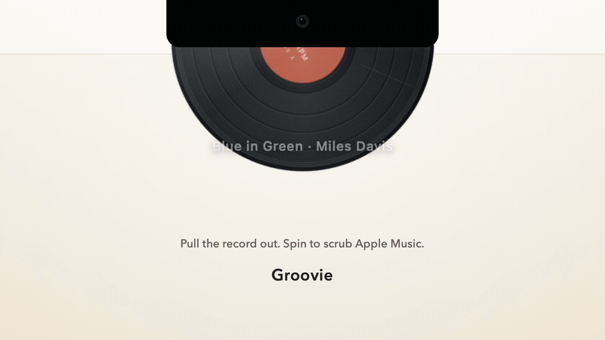

<p align="right"><a href="README.ko.md">한국어</a> · English</p>

<p align="center">
  <picture>
    <source media="(prefers-color-scheme: dark)" srcset="docs/assets/hero-dark.jpg">
    
  </picture>
</p>

<h1 align="center">Umak</h1>

<p align="center"><em>A turntable hidden in the MacBook notch.</em></p>

<p align="center"><strong>Click to pause. Swipe to skip. Pull to explore. Keep the album on your desktop.</strong></p>

<p align="center">
  <a href="#requirements"></a>
  <a href="#requirements"></a>
  <a href="#apple-music-and-spotify"></a>
  <a href="#how-it-works"></a>
  <a href="LICENSE"></a>
</p>

<p align="center">
  <a href="#why-the-notch">Why the Notch?</a> ·
  <a href="#features">Features</a> ·
  <a href="#requirements">Requirements</a> ·
  <a href="#install">Install</a> ·
  <a href="#usage">Usage</a> ·
  <a href="#how-it-works">How it works</a> ·
  <a href="#development">Development</a> ·
  <a href="#tuning">Tuning</a> ·
  <a href="#known-limitations">Limitations</a> ·
  <a href="#contributing">Contributing</a>
</p>

---

Umak turns the MacBook camera notch into a control surface for Apple Music and Spotify. Click the notch to
pause, swipe across it to skip, or pull the record down to explore. The record lives inside the
notch: pull it far enough and it snaps out with a magnetic detent. Grab it and turn it sideways to
seek — slowly for precision, quickly to jump. Pull once more and it stays out, ready for play/pause
and track changes. Let go and it drops back into the notch.

You do not need the record to change what is playing. The closed notch is a control of its own:
click it to pause or resume, and swipe across it to change tracks. When you want more, pull the
record out. When you love what is playing, keep it: ⌥-drag the open record onto the desktop to
leave the vinyl there, or ⌥-click to place the album artwork as a sleeve on the desktop.

Nothing here is a slider or a popover: the record is the interface, and the desktop is where an
album can stay.

<p align="center">
  <picture>
    <source media="(prefers-color-scheme: dark)" srcset="docs/assets/umak-demo-dark.gif">
    
  </picture>
</p>

## Why the Notch?

The notch is always black, always top-centre, and always above whatever you are doing. That makes
it the one piece of screen real estate where a skeuomorphic object can live without competing with
the desktop. Umak treats the notch as a record sleeve, the record as the control, and the
desktop as the shelf where an album can stay.

Only the lower half of the record is ever visible. That is a deliberate constraint: the silhouette
reads as *a record pulled halfway out of a sleeve*, and it gives the interaction an obvious
resting place.

## Features

### The record

- **Pull to grab.** A vertical drag that starts in the notch begins pulling right away. At the
  halfway point the magnet takes over and the record snaps fully out with a light haptic. Release
  before the detent and it springs back.
- **Drag to rotate.** Hold the record and move sideways to turn it. Right rewinds, left
  fast-forwards, and the faster you move, the further it jumps. Seeking stops at the beginning
  or end of the track, and the record stops turning there too.
- **Pin it.** While grabbed, pull farther — or grab again within a second — and the record stays
  out. A translucent gauge under the record fills as you pull, and a faster pull fills it faster.
- **Put it back.** Click the vinyl, drag up, or scroll up. The record springs into the notch and
  playback resumes at the chosen position. If it was paused before, it stays paused.
- **Wiggle to cancel.** Shake the record — four direction changes within one second — to abandon
  the seek and return to where you grabbed it.
- **Return to 33⅓.** When the scrub ends, manual rotation eases back into playback at 33⅓ RPM.

### Playback

- **Click the label.** Once pinned, clicking the centre label toggles play/pause and the record
  stays out. The record and the menu bar update immediately.
- **Hover hint.** On a pinned record, hovering the label darkens it, reveals a faint ❚❚ or ▶
  glyph, and changes the cursor to a pointing hand. The vinyl itself never reacts.
- **Skip tracks.** A horizontal two-finger swipe over the notch, or over a pinned record's label,
  goes to the next or previous track. On the pinned record, a swipe that starts on the vinyl still
  scrubs.
- **Click the notch.** With the record closed, a single click over the notch toggles play/pause.
  With no track loaded, it brings the active player forward instead.

### The desktop

- **Take the record with you.** With a fully opened record, hold ⌥ and drag it onto the desktop
  to leave a still copy of the vinyl there.
- **Put the cover on the desktop.** ⌥-click instead to place the same track as an album sleeve:
  the cover with the record sliding out. The copy uses the track's album artwork, or the
  generated paper label when there is none.
- **Turn it in your hands.** ⌥-click a copy to cycle open sleeve → closed sleeve → bare disc →
  open sleeve. The cover stays put while the record slides in and out.
- **It stays where you left it.** Copies are snapshots: they never rotate, sync, or react to
  playback. They survive a relaunch, stay on the display where they were placed, and can be
  cleared from the status menu.

### The notch

- **Out of the way.** The overlay is a borderless panel that sits above the status bar without
  taking focus or activating the app, and there is no Dock icon.
- **Works without a notch.** On displays without a camera housing, the top-centre strip behaves
  exactly the same way.
- **First-run hint.** On a display without a notch, a small card under the strip introduces the
  hidden gestures: click to play/pause, swipe with two fingers to change tracks, pull down for the
  record. It never takes mouse events, disappears on the first gesture, and can be replayed from
  the status menu.
- **Status menu.** A fixed-width header with the logo, track, artist, and progress. Long titles
  scroll; short ones stay still. Only actionable states — player closed, no track, permission
  needed — are surfaced there.
- **Five skins.** Classic black, rust, deep teal, smoke, and mono. The label always follows the
  track: album art when available, otherwise a paper label generated from the track's palette.
- **English and Korean UI**, discovered from JSON files at runtime.

### Apple Music and Spotify

- Drives either player, chosen automatically or pinned from the **Player** submenu.
- Works with a normal Apple Music or Spotify install: no account setup or API keys, and no extra
  permission beyond Automation.
- Reads the current track, play state, position, duration, and artwork through AppleScript.
- Seeks with a ~100 ms target.
- Opens the active player when it is not running, and brings it forward when there is no track.
- Provides clear guidance when permissions are missing.

## Requirements

- macOS 14 Sonoma or later (developed and tested on macOS 26)
- Swift 6.0+ toolchain — Command Line Tools are enough; there is no Xcode project
- Apple Music or Spotify for real playback; the built-in demo mode works without either

## Install

```sh
git clone https://github.com/jseook11/Umak.git
cd Umak
make app
open build/Umak.app
```

Move `build/Umak.app` to `/Applications` to keep it around, and add it to
**System Settings → General → Login Items** if you want it at login.

There is no installer and no notarized binary yet. The app is ad-hoc signed locally, which is
enough for development and for the Automation prompt.

### Updates

Umak checks the public GitHub release feed once a day. When a newer version exists, the status
menu shows **Umak X.Y.Z Available**; choosing it opens the release page. Nothing is downloaded
or installed automatically. Use **Check for Updates…** in the status menu to check immediately.

### First launch

1. Umak appears in the menu bar. It has no Dock icon and no main window.
2. The first command triggers **“Umak wants to control Music”** (or **Spotify**, whichever
   player is active). Choose **Allow**.
3. If access was denied, enable it in **System Settings → Privacy & Security → Automation →
   Umak → Music** (or **Spotify**), or use **Reconnect to Music/Spotify** in the status menu.
4. On a display without a notch, a one-time gesture card appears under the top-centre strip.
   Choose **Show Gesture Tips** from the status menu to see it again.

## Usage

<p align="center">
  
</p>

For a full walkthrough of every gesture, threshold, and edge case, see the
[interaction guide](docs/ux-guide.md) (currently in Korean).

| You want to… | Mouse | Trackpad |
| --- | --- | --- |
| Wake the notch | Move the pointer over it | Move the pointer over it |
| Pull the record out | Drag down | Scroll down |
| Seek | Drag left / right while holding | Scroll left / right over the vinyl |
| Pin it out | Pull farther, or grab again within 1 s | Keep scrolling down, or pause and scroll down again |
| Play / pause | Click the label (pinned) or the notch (closed) | Click the label or the notch |
| Next / previous track | — | Swipe right / left |
| Put it back | Click the vinyl, or drag up | Scroll up |
| Copy the record to the desktop | ⌥-drag a fully opened record | ⌥-drag |
| Put the album on the desktop | ⌥-click a fully opened record | ⌥-click |
| Move a desktop copy | ⌥-drag it | ⌥-drag |
| Cycle open sleeve → closed sleeve → disc | ⌥-click a desktop copy | ⌥-click |
| Remove a desktop copy | Drag its centre into the top notch area | Same |
| Cancel a seek | Shake four times in one second | — |

With the record closed, the notch strip still has its own controls:

<p align="center">
  
</p>

### Pull and grab

The record is rendered as a plain full circle; the hardware notch (or the top edge of a display
without one) hides its upper half, so only the lower semicircle is visible, with its centre exactly
on the notch's bottom edge.

A pull is only recognised when the first movement is vertical and downward. The record follows
the pointer, then snaps fully out at the detent; releasing before it lets the record spring back.
Once grabbed, an upward lift puts it away.

### Seek

Grab the record and move sideways. Moving right rewinds; moving left fast-forwards. Slow movement
is precise, fast movement covers more ground: the `ScrubEngine` maps pointer speed onto a
sensitivity curve instead of using a fixed rate. Seeking stops at either end of the track.

A record that is still being pulled out waits for a clear sideways drag before it scrubs; once
pinned, much smaller movements count.

### Pin and put back

A grabbed record is not pinned yet. It stays out when one of these confirm gestures happens:

- pull farther beyond the detent — a fast pull fills the gauge faster;
- release, then grab again within a second;
- with a trackpad, keep scrolling down, or pause and scroll down again.

A translucent gauge under the record starts at zero when the record snaps out and fills as you
confirm.

Once pinned, click the label to toggle playback, swipe the label horizontally to change tracks,
and click the vinyl, drag up, or scroll up to close. Without a confirm gesture, the record waits
briefly after release and then springs back.

### Desktop copies

Once the record is fully out — pinned or not — hold ⌥ and drag it to leave a still copy of the
vinyl on the desktop. ⌥-click without dragging places the same track as an album sleeve instead:
the cover with the record sliding out.

A copy uses the track's album artwork, or the generated paper label when artwork is unavailable.
⌥-click it to cycle through **open sleeve → closed sleeve → bare disc → open sleeve**; the cover
never moves while the record slides in and out.

Copies are decorative snapshots. They never play, scrub, skip, rotate, or follow track changes.
⌥-drag to move one, and drop its centre on the top notch area to remove it. They survive a
relaunch, stay on the display where they were placed, and the status menu can clear them all.

### Trackpad

Scroll input has no button-release event, so the scroll policy is time-based rather than
release-based:

- **Down** pulls the record out; the halfway point snaps it open.
- **Left / right over the vinyl** scrubs, with the same speed-sensitive mapping as dragging.
- **Left / right over the notch or a pinned label** changes tracks. A skip needs a long, clearly
  horizontal gesture, and each gesture skips only once.
- **Up** puts the record back.
- **No input for a moment** after opening puts the record back, unless it has been confirmed.
- Momentum is ignored, so a flick does not keep scrubbing after your fingers leave the trackpad.

### Cancel a seek

While holding the record, shake it left and right — four direction changes within one second. The
seek is discarded, the position returns to where you grabbed it, and a light haptic confirms the
cancel. If the record was pinned, it stays pinned.

### Displays without a notch

On an external display, the top-centre strip becomes the interaction area. The record emerges
from the top edge of the screen, just as it does from a physical notch. When several displays are
connected, the built-in notched display is preferred.

## How it works

The interaction is a small state machine with two inputs — pointer drags and two-finger scroll —
that feed the same model:

```
idle ── hover ──► armed ── pull ──► pulling ── detent ──► grabbed
  ▲                                                          │
  │                                               drag ↔ ──► scrubbing
  │                                                          │
  │                                          confirm or re-grab
  │                                                          ▼
  └───────────── click / drag up / scroll up ──────────── pinned
```

Some implementation details that make the physical metaphor work:

- **A panel that does not activate.** `OverlayPanel` is a borderless `NSPanel` with
  `.nonactivatingPanel`, sitting at `.statusBar + 1`. Clicking the record does not bring Umak
  forward or change the frontmost app.
- **Input below the views.** The SwiftUI hosting view returns `nil` from `hitTest`; a transparent
  `NSView` receives every mouse event. This keeps gesture handling away from SwiftUI's layout and
  animation.
- **Two coordinate systems.** Screen events arrive with a bottom-left origin; the stage is laid out
  top-left. `contentPoint(forScreenPoint:)` converts before any hit-testing happens.
- **Hover without a key window.** Global and local `mouseMoved` monitors are combined with the
  panel's tracking area, so the label can react even though the panel never becomes key.
- **One serial bridge for every player.** AppleScript is process-global and not thread-safe, so
  every command from either player goes through the same serial queue; player-specific queues let
  one player's reply arrive for the other. The position is estimated locally between polls, and a
  requested play state is held briefly until the player agrees, so a stale read cannot flip the
  record back.
- **Automatic player selection.** `PlayerCoordinator` runs every installed player's service in
  auto mode: the one driving the record polls normally, the other at a 30 s safety-net probe, so
  starting playback in the other app is noticed without doubling the AppleScript cost. A
  missing player is never started and is greyed out in the Player submenu. Pinning a player stops
  the other one entirely. On a cold start it reopens only the last player it actually drove, and
  launches nothing when there is no history. A takeover that becomes preferable while the record
  is out waits until the record returns, so a gesture never switches players underneath it.
- **One axis per scroll gesture.** `ScrollAxisLock` decides between horizontal and vertical early
  and keeps that decision until the gesture ends. It is a pure value type, which makes the tricky
  part of track skipping straightforward to test.

### Project layout

```
Sources/UmakKit/
  App/AppDelegate.swift                 menu-bar app, status menu, permissions
  Notch/NotchGeometry.swift             notch/no-notch detection, window frames
  Notch/OverlayPanel.swift              non-activating overlay panel and input view
  Interaction/VinylLayout.swift         state types, pull/exposure curve, geometry
  Interaction/ScrubEngine.swift         velocity-sensitive scrub math and clamping
  Interaction/ScrollAxisLock.swift      horizontal/vertical axis locking for scroll
  Interaction/ConfirmAccumulator.swift  pin gauge and velocity assistance
  Interaction/WiggleDetector.swift      shake-to-cancel detection
  Interaction/OverlayController.swift   gesture state machine, windows, springs
  Interaction/VinylViewModel.swift      state published to the UI
  Music/ScriptedPlayerBridge.swift      shared bridge contract and player descriptor
  Music/ScriptedMusicService.swift      polling, availability, artwork cache
  Music/AppleMusicBridge.swift          Music.app AppleScript and embedded artwork
  Music/SpotifyBridge.swift             Spotify.app AppleScript and artwork URL
  Music/ArtworkLoader.swift             HTTPS cover download and downsample
  Music/ArtworkThumbnailer.swift        shared artwork thumbnail and downsample
  Music/NowPlaying.swift                player-agnostic track snapshot
  Music/PlayerCoordinator.swift         auto/pin selection between the two services
  Desktop/DesktopRecord.swift           copy snapshot and versioned document
  Desktop/DesktopRecordStore.swift      JSON store, artwork files, restore
  Desktop/DesktopRecordWindow.swift     borderless copy window and hit testing
  Desktop/DesktopRecordController.swift drag, style cycle, delete, multi-display
  Desktop/DesktopArtworkRenderer.swift  still sleeve/disc rendering and cache
  UI/VinylSkin.swift                    record palettes, persistence, track colors
  UI/RecordTexture.swift                grooves, bands, runout, label print
  UI/VinylStageView.swift               SwiftUI stage, hover hint, confirm gauge
  UI/VinylRootView.swift                stage composition
  UI/VinylDiscView.swift                record drawing
  UI/RotatingDiscView.swift             Core Animation-backed record rotation
  UI/Theme.swift                        shared colors and metrics
  UI/GestureHintView.swift              first-run gesture card and its panel
  UI/BrandMark.swift                    notch + record menu-bar template mark
  UI/MenuHeaderView.swift               fixed-width header, marquee, progress
  Localization/                         language discovery and typed string keys
  Resources/Localization/               en.json, ko.json
  Support/RecentSet.swift               small bounded recency set
  Support/UpdateChecker.swift           daily GitHub release check
  Debug/                                demo player and self-checks
Resources/Info.plist                    LSUIElement, automation description, icon
Resources/AppIcon.icns                  packaged macOS app icon
docs/assets/                            README images and gesture map
docs/design/                            app-icon master art
docs/localization/                     translation guide, JSON schema, key context
docs/ux-guide.md                       full interaction guide (Korean)
docs/tuning.md                         constants, defaults, and implementation notes
docs/menu-ui-spec.md                   status menu layout and behavior
docs/desktop-records.md                design note: decorative desktop records
docs/record-crate.md                   design note: record crate / playlists (unbuilt)
docs/record-break.md                   rejected alternative: breaking the record
Scripts/                                app bundling, icon generation, localization checks
```

No third-party packages. The app is a SwiftPM executable plus a library target, bundled into an
`.app` by `Scripts/build-app.sh`.

## Development

```sh
make app        # build build/Umak.app (release)
make run        # build and launch
make test       # headless interaction checks
make demo       # run the demo sequence and capture build/demo.png
make icon       # regenerate Resources/AppIcon.icns
make l10n-check # validate the language files
```

`make test` builds the app and runs it with `--self-test`, then checks that every language file
has the same keys and placeholders. There is no XCTest target: the interaction rules are pure
values and are checked directly, which keeps the tests fast and independent of the window server.

### Development flags

```sh
open build/Umak.app --args --fake-music
open build/Umak.app --args --fake-music --demo
open build/Umak.app --args --fake-music --simulate-no-notch
open build/Umak.app --args --fake-music --demo --skin=rust
open build/Umak.app --args --desktop-demo --fake-music
open build/Umak.app --args --gesture-hint
open build/Umak.app --args --check-updates
```

| Flag | What it does |
| --- | --- |
| `--fake-music` | Uses a demo player with three tracks instead of Music. |
| `--demo` | Plays a pull → rewind → fast-forward → release sequence automatically. |
| `--desktop-demo` | Seeds a bare disc and an album sleeve in a throwaway store, without touching your real desktop copies. |
| `--desktop-demo-toggle` | Cycles the seeded disc once, exercising the same path as an ⌥-click. |
| `--simulate-no-notch` | Shows the no-notch layout on a notched Mac. |
| `--gesture-hint` | Forces the first-run gesture card, even on a notched display. |
| `--skin=<id>` | Pins one of `classic`, `rust`, `teal`, `smoke`, `mono` for this run. |
| `--player=<id>` | Pins `auto`, `music`, or `spotify` for this run without saving the choice. |
| `--long-title` | Makes the demo title long enough to exercise the menu-header marquee. |
| `--lang=<code>` | Pins the UI language for this run, e.g. `en` or `ko`. |
| `--check-updates` | Checks the release feed immediately and shows the result, bypassing the daily limit. |
| `--self-test` | Runs the headless checks and exits. |

### Localization

The UI follows the system language. English and Korean ship by default, and each language is a
single JSON file in `Sources/UmakKit/Resources/Localization/`. Adding a file is enough to make
a language discoverable.

```sh
swift Scripts/new-language.swift ja "日本語"
make l10n-check
make app
open build/Umak.app --args --lang=ja
```

See [docs/localization/README.md](docs/localization/README.md) for the translation rules and
[docs/localization/keys.md](docs/localization/keys.md) for the context of each key. Both are
written in English.

## Tuning

The feel is defined by a small set of constants in `VinylLayout`, `OverlayController`,
`ScrollAxisLock`, and `ScrubEngine.ScrubTuning`. The full table, defaults, and the reasoning
behind them live in [docs/tuning.md](docs/tuning.md).

Record palettes are in `VinylSkin`; the selected skin is stored under `umak.skinID` in
`UserDefaults`.

## Known limitations

- Scroll input has no release event, so an unconfirmed record returns after 1.4 s of inactivity
  rather than when the fingers leave the trackpad.
- Seeking targets 100 ms, but Apple Music does not guarantee that precision on every track or
  stream.
- Album art comes from Music's embedded data or Spotify's artwork URL. If that read or download
  fails, a generated paper label is used instead.
- Desktop copies are snapshots: changing the track, artwork, or skin later does not update an
  existing copy. Create a new one to pick up the change.
- On a display without a notch, the open stage covers the top-centre part of the menu bar while
  the record is out.
- The pointer is not visible over a physical notch. Aim for the top-centre of the screen when
  starting a drag.
- Spotify's playback-state notification is undocumented. Umak only treats it as a hint and
  keeps polling, so if a future Spotify stops posting it, updates merely slow to the polling
  cadence. Seeks and a contextual "previous" do not post it.
- Auto mode probes only installed players, and with no launch history it opens nothing on a cold
  start. Probing a running player can still trigger its Automation prompt even if you normally use
  the other one, and a denied probe is not selected over a usable player; pin a player to avoid
  the prompt entirely.
- Rebuilding changes the ad-hoc signature, so macOS may ask for Automation permission again during
  development.

## Contributing

Issues and pull requests are welcome. Run `make test` before sending a change. If you add a
user-facing string, add it to every language file and run `make l10n-check`.

The interaction rules live in pure types (`ScrubEngine`, `ScrollAxisLock`, `ConfirmAccumulator`,
`WiggleDetector`), and the self-checks exercise them directly. Keeping new logic at that level
makes it testable without a window server.

## License

[MIT](LICENSE) © Umak contributors.

Umak is an independent project and is not affiliated with Apple Inc. Apple Music is a trademark
of Apple Inc.
